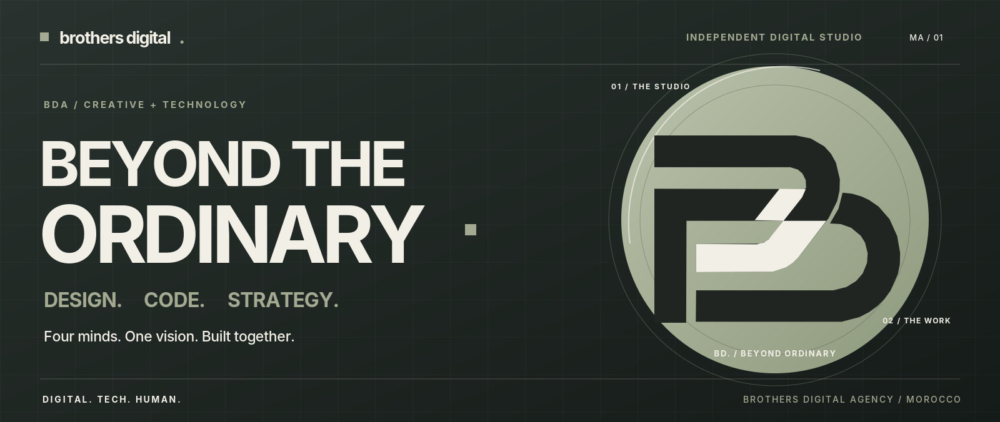
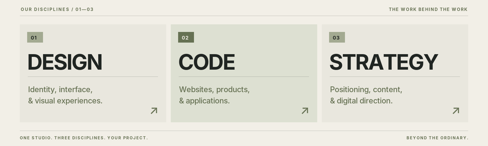
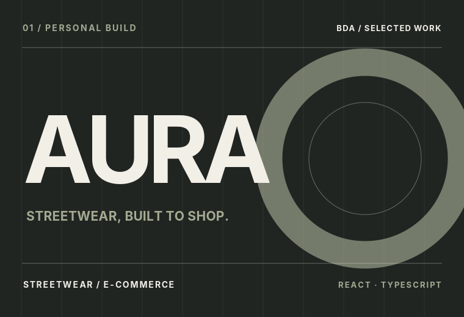
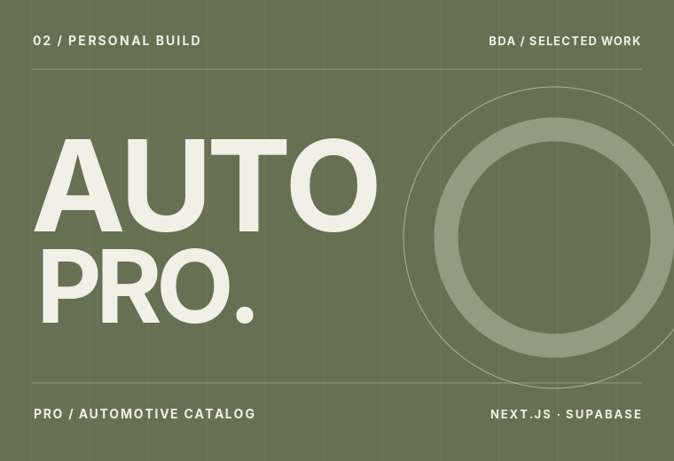
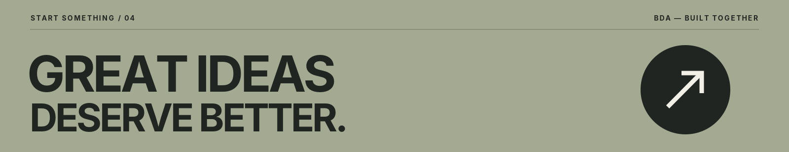

<!-- BDA / OFFICIAL PROFILE — Brothers Digital Agency -->

  

  
<strong>Independent digital & creative studio · Morocco</strong>

  

    <a href="https://brothers-digital.pages.dev/">Explore our website</a> &nbsp;•&nbsp;
    <a href="https://brothers-digital.pages.dev/en/work/">Selected work</a> &nbsp;•&nbsp;
    <a href="https://www.instagram.com/brothers_digital_agency/">Instagram</a> &nbsp;•&nbsp;
    <a href="https://brothers-digital.pages.dev/en/contact/">Work with us</a>
  

 

### 01 / WE ARE BROTHERS DIGITAL.

**Four minds. One vision.** We are an independent Moroccan studio combining **design, code, and strategy** to make digital ideas feel distinctive, useful, and alive.

We create websites, applications, visual identities, and digital experiences — built with intention, never just for appearance.

> **Beyond the Ordinary. Digital & Tech.**

 

  

 

### 02 / WORK THAT SPEAKS FOR ITSELF.

Ideas become memorable when every detail has a purpose. Here are selected **personal projects and studio explorations by our team** — not presented as commissioned agency work.

<table>
<tr>
<td width="50%" valign="top">
  
  <h3>AURA — E-commerce</h3>
  
A streetwear shopping experience exploring product discovery, catalog filters, and cart journeys.

  
<strong>React · TypeScript</strong>

  <a href="https://github.com/mouadbusni/AURA-V9-main">View project source ↗</a>
</td>
<td width="50%" valign="top">
  
  <h3>AutoPro — Automotive Catalog</h3>
  
A product catalog exploring search, category navigation, and data-connected shopping interfaces.

  
<strong>Next.js · TypeScript · Supabase</strong>

  <a href="https://github.com/mouadbusni/Car-parts">View project source ↗</a>
</td>
</tr>
</table>

Our studio website is also built as a bilingual experience with carefully considered motion and interactive 3D elements. [Explore the source →](https://github.com/mouadbusni/brothers-digital)

 

### 03 / OUR APPROACH.

**Discover → Design → Build → Refine.** We start by understanding the challenge, establish a clear direction, then craft and improve every interaction.

`Brand identity` &nbsp; `UI / UX` &nbsp; `Creative development` &nbsp; `React` &nbsp; `TypeScript` &nbsp; `Next.js` &nbsp; `WebGL` &nbsp; `Digital strategy`

 

### 04 / LET'S CREATE SOMETHING THAT MATTERS.

 

**Have a project in mind?** &nbsp; [Start the conversation ↗](https://brothers-digital.pages.dev/en/contact/)

© Brothers Digital Agency · Based in Morocco · Four minds. One vision. Built together.

